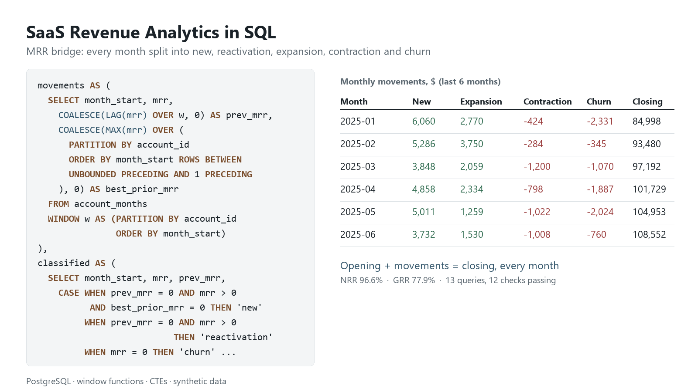

# SaaS Revenue and Product Analytics in SQL

Thirteen advanced PostgreSQL queries that answer the questions a SaaS finance, growth or customer success team asks every month: where MRR came from and went, how cohorts retain, which signups convert, how customers use the product, and which accounts are at risk.

The company, Fernhollow Software, is fictional, and all of its data is synthetic: 600 accounts, 30 months of plan history, 118k product events and 948 support tickets, generated by a seeded script.



## The data

| Table | Rows | What it holds |
|---|---|---|
| `accounts` | 600 | signup date, region, industry, acquisition channel, who referred them |
| `subscriptions` | 612 | plan history as a **type 2 slowly changing dimension**: one row per plan and seat state, `valid_from` inclusive, `valid_to` exclusive |
| `users` | 1,426 | the people inside each account |
| `events_raw` | 119,607 | product events as loaded, **including 1,768 duplicate deliveries** |
| `support_tickets` | 948 | priority, opened, first response and resolved times |

`events` is a view over `events_raw` that keeps the first delivery of each event, and every product query reads it. The data runs from January 2023 to June 2025.

## The queries

| # | Question | Techniques |
|---|---|---|
| [1](sql/01_duplicate_events.sql) | How many raw events are duplicate deliveries? | `ROW_NUMBER` over a natural key, `GROUPING SETS` |
| [2](sql/02_monthly_mrr.sql) | What was MRR, paying accounts and ARPA at each month end? | generated month spine, range join to SCD2 history, `LAG` |
| [3](sql/03_mrr_bridge.sql) | What moved MRR each month: new, reactivation, expansion, contraction, churn? | account × month grid, `LAG`, running `MAX` over prior rows, `FILTER` |
| [4](sql/04_cohort_retention.sql) | What share of each quarterly cohort still pays after 1, 3, 6, 9 and 12 months? | month arithmetic, pivot with `FILTER`, blanking cells a cohort has not reached |
| [5](sql/05_net_revenue_retention.sql) | What are 12-month net and gross revenue retention by region? | point-in-time snapshots, `LEAST`, `ROLLUP` |
| [6](sql/06_signup_funnel.sql) | Which channels convert, and how much does early activation matter? | boolean `FILTER` aggregates, `percentile_cont`, `GROUPING SETS` |
| [7](sql/07_sessions_by_plan.sql) | How long are product sessions on each plan? | sessionization with `LAG` and a running `SUM`, point-in-time join to plan history |
| [8](sql/08_weekly_streaks.sql) | Which accounts had the longest run of consecutive active weeks? | gaps and islands, `DISTINCT ON` |
| [9](sql/09_rolling_active_users.sql) | What are DAU, WAU, MAU and stickiness each day? | date spine, range self-join, `COUNT(DISTINCT)` with `FILTER`, moving average |
| [10](sql/10_referral_tree.sql) | Which customers brought in the most revenue through referral chains? | `WITH RECURSIVE`, depth and path tracking, cycle guard |
| [11](sql/11_revenue_mix.sql) | How is current MRR split by region and plan, with all subtotals? | `GROUPING SETS`, `GROUPING()` labels, scalar subquery |
| [12](sql/12_support_sla.sql) | Are first responses meeting SLA targets by priority? | interval arithmetic, median and p90, open-ticket handling |
| [13](sql/13_churn_risk.sql) | Which paying accounts should customer success call first? | time-window `FILTER`, `LATERAL` subquery, rule-based scoring |

## What the data shows

**MRR grew from $78.9k to $108.6k in the first half of 2025.** New business added $28.8k, expansion $13.7k and reactivations $0.3k, against $13.2k lost to contraction ($4.7k) and churn ($8.4k). The bridge reconciles every month: opening MRR plus the five movements equals closing MRR.

| Month | Opening | New | Expansion | Contraction | Churn | Closing |
|---|---:|---:|---:|---:|---:|---:|
| Apr 2025 | 97,192 | 4,858 | 2,334 | -798 | -1,887 | 101,729 |
| May 2025 | 101,729 | 5,011 | 1,259 | -1,022 | -2,024 | 104,953 |
| Jun 2025 | 104,953 | 3,732 | 1,530 | -1,008 | -760 | 108,552 |

**Net revenue retention is 96.6% overall, but only North America is above 100%.** LATAM lost 40% of its paying accounts in the year.

| Region | Base accounts | NRR | GRR | Logo churn |
|---|---:|---:|---:|---:|
| North America | 51 | 107.6% | 77.5% | 25.5% |
| APAC | 21 | 98.9% | 83.8% | 28.6% |
| Europe | 46 | 86.3% | 77.1% | 17.4% |
| LATAM | 15 | 85.1% | 67.1% | 40.0% |
| **All regions** | **133** | **96.6%** | **77.9%** | **24.8%** |

**Activation is the strongest conversion signal.** Accounts that connected an integration in their first week paid within 30 days 55.3% of the time, against 15.7% for those that did not. Referral and partner signups convert best (49.5% and 48.3%), and paid search worst (26.4%).

**High-priority tickets breach SLA most often.** 35.2% of high-priority tickets waited longer than the 4-hour target for a first response, against 25.4% for urgent tickets.

Full outputs for every query are in [`results/`](results/).

## Design notes

- **Month-end snapshots.** MRR is measured on the last day of each month. A plan change and a reversal inside the same month cancel out, as they do in most finance reporting.
- **New vs reactivation.** An account returning to MRR is "new" only if it has never paid before. The running `MAX` over earlier months tells the two apart without a second pass.
- **Point-in-time joins.** Sessions and MRR join to the plan row that was valid on that date, so an upgrade never rewrites earlier months.
- **Open items count.** A ticket still waiting for a reply at the end of the data counts by how long it has waited so far, rather than being dropped.
- **Portable SQL.** The queries avoid integer division and engine-specific shortcuts, so the same files run on PostgreSQL and DuckDB.

## Run it

PostgreSQL 14 or later:

```bash
createdb fernhollow
psql -d fernhollow -f run_all.sql
```

Or check every query without a database server. This runs all 13 on DuckDB, saves the results and checks that the numbers reconcile:

```bash
pip install duckdb
python tests/run_checks.py
```

To regenerate the data (same seed, same files):

```bash
python scripts/generate_data.py
```

## Checks

`tests/run_checks.py` runs 12 consistency checks, and all of them pass:

- the clean events view holds exactly raw events minus duplicates
- the MRR bridge balances every month, and each closing MRR equals the next opening MRR
- the bridge matches the monthly MRR series in all 30 months
- cohort sizes add up to every account that ever paid
- the NRR base equals June 2024 MRR, and GRR never exceeds NRR
- the funnel covers all 600 signups
- DAU ≤ WAU ≤ MAU on every day
- region and plan subtotals each add up to total MRR, which equals June 2025 MRR
- every support ticket appears in exactly one SLA row

## Repository layout

```
sql/00_schema.sql          tables, indexes and the de-duplicated events view
sql/01 … 13_*.sql          one analysis per file
run_all.sql                PostgreSQL: build, load and run everything
tests/run_checks.py        DuckDB: run everything and check the numbers reconcile
scripts/generate_data.py   seeded generator for the synthetic data
data/                      the CSVs
results/                   each query's output as CSV
```

All data in this repository is synthetic. Fernhollow Software and every account in it are invented.
